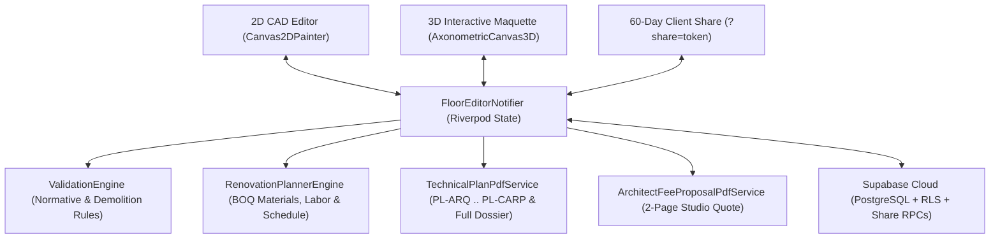

# Trazzik — Parametric 2D/3D Architectural CAD, Remodeling & Executive Deliverables Platform

Trazzik is a cross-platform (**Web, Android, iOS, Desktop**) architectural design, normative remodeling validation, 3D finish configuration, and executive deliverables platform built with **Flutter**, **Riverpod**, and **Supabase**. It unifies early-stage spatial layout, real-time 2D/3D material experimentation, automated Colombian construction quantity takeoffs (**BOQ / APU in COP**), multi-discipline executive PDF plan sheets, and studio fee proposals into a single parametric source of truth.

---

## Quick Path

1. **Configure Environment:**
   ```bash
   cp .env.example .env
   # Set SUPABASE_URL and SUPABASE_ANON_KEY in .env
   flutter pub get
   ```
2. **Verify Static Analysis & Test Suite (`110/110` passing):**
   ```bash
   flutter analyze --no-pub
   flutter test --no-pub -j 2
   ```
3. **Run or Build with Compile-Time Environment Injection:**
   ```bash
   # Run on Web (Chrome)
   flutter run -d chrome --dart-define-from-file=.env

   # Build Release APK for Android (Impeller Vulkan enabled)
   flutter build apk --release --dart-define-from-file=.env --no-pub
   ```

---

## Core Capabilities

| Domain | Capability | Key Implementation |
| :--- | :--- | :--- |
| **Parametric 2D CAD & Normative Engine** | Lot polygon setup with normative setbacks (`front`, `rear`, `left`, `right`), buildable vs. non-buildable zoning, snapping, orthogonal walls, openings (doors/windows), stairs, 1-click Smart Auto-Furnish (`AutoFurnishEngine`), interactive 2D Laser Tape Measure & Clearance Checker (`≥ 0.90m`), calibrated Blueprint & Structural Grid Underlay, per-floor undo/redo, and multi-story layout generator. | `lib/core/geometry/`, `lib/core/validation/validation_engine.dart`, `lib/features/editor_2d/`, `lib/features/modules/domain/auto_furnish_engine.dart` |
| **Remodeling & Demolition Validation** | Element lifecycle tracking (`existing`, `preserved`, `toDemolish`, `toModify`, `isNew`, `future`) and automated spatial replacement/expansion conflict resolution (`ReplacementRelationship`). | `lib/features/demolition/`, `lib/core/geometry/element_status.dart` |
| **Interactive 3D Maquette & Finish Configurator** | 120Hz GPU-friendly axonometric 3D engine with cutaway maquette mode (`1.20m`) and full-height mode (`2.60m`), interactive X/Y vertical cross-section cuts, multi-part parametric 3D furniture, 1-click Roomstyle palettes, `2700K` night interior lighting, and tap-to-edit 3D/2D floor & wall finishes (`FinishMaterialCatalog`). | `lib/features/viewer_3d/`, `lib/core/materials/finish_material.dart` |
| **60-Day Interactive 3D Client Share Links** | Architects generate 60-day cloud links (`https://trazzik.app/?share=<token>`) and direct access codes from the 3D Viewer. Clients open the link on Web or enter the code on Mobile to orbit the 3D model and test floor/wall finishes in real time without altering structural geometry. | `lib/features/viewer_3d/presentation/widgets/client_share_link_dialog.dart`, `open_shared_link_dialog.dart` |
| **Executive Multi-Discipline PDF & CAD Exporter** | Vector CAD (`.DXF` AIA layers, `.gltf` 2.0 PBR) + high-DPI PDF sheet generator supporting `A3` / `A4`, `1:50` / `1:75` / `1:100` / `Auto` scales, professional title blocks, and 9 disciplines (`PL-01`, `PL-COMP`, `PL-3D`, `PL-DEM`, `PL-ELEC`, `PL-HID`, `PL-ACA`, `PL-VAN` Door/Window Schedule, `PL-CARP` Millwork) plus 1-click **Complete Executive Dossier**. | `lib/features/plan_export/` |
| **AI Architectural Advisor & BOQ Engine** | Spatial ergonomics audit (NSR-10 / residential standards) and automated Bill of Quantities (`RenovationPlannerEngine`) calculating flooring, wall finishes, Drywall RH/standard ceilings, LED coves, plumbing, labor crews, and schedule phases in Colombian Pesos (`COP`) with downloadable PDF and `.CSV` (Excel/Sheets) reports. | `lib/features/ai_advisor/` |
| **Architect Fee Proposal & Schedule Generator** | 2-page studio-grade fee quotation (`Cotización de Honorarios y Cronograma`) with 3 pricing formulas (`$/m²`, `% of construction`, `fixed fee`), dynamic 6-phase business-day schedule, `40% / 30% / 30%` payment milestones, and cloud draft persistence (`projects.fee_proposal_config`). | `lib/features/fee_proposal/` |

---

## Architecture & Data Flow

Trazzik follows a strict **Feature-First Clean Architecture** where `FloorEditorNotifier` acts as the single parametric source of truth across 2D, 3D, BOQ, and PDF engines:



### Repository Layout

```text
lib/
├── main.dart                          # App entrypoint, theme/locale binding & ?share=<token> gate
├── core/
│   ├── cad/                           # Architectural CAD symbols (doors, windows, north arrow, furniture)
│   ├── geometry/                      # Point2D, Polygon2D, BoundingBox2D, GeometryEngine, ElementStatus
│   ├── i18n/                          # Bilingual dictionary (es / en) & appLocaleProvider
│   ├── materials/                     # FinishMaterialCatalog (floor_* and wall_* procedural materials)
│   ├── pdf/                           # Unicode TTF font loader for PDF generation
│   ├── supabase/                      # SupabaseConfig, platform env loader & Riverpod providers
│   ├── theme/                         # AppTheme & semantic AppColors ThemeExtension (Dark / Light)
│   └── validation/                    # ValidationEngine (setbacks, overlaps, openings, remodeling rules)
└── features/
    ├── ai_advisor/                    # Spatial audit engine, RenovationPlannerEngine (BOQ), .CSV & PDF export
    ├── authentication/                # Supabase Auth repository & AuthScreen (with client 3D code entry)
    ├── demolition/                    # ReplacementRelationship domain model & remodeling workflows
    ├── editor_2d/                     # FloorEditorNotifier, 2D canvas painter, inspector & declarative AppBar
    ├── fee_proposal/                  # ArchitectFeeProposal domain model, interactive dialog & 2-page PDF
    ├── floors/                        # Floor domain model & SupabaseFloorRepository
    ├── lots/                          # Lot & ZoningZone domain models
    ├── modules/                       # Module, SubModule & FurnitureCatalog domain models
    ├── plan_export/                   # 7-discipline TechnicalPlanPainter (incl. PL-3D), AutoCAD .DXF exporter, PL-CARP & PDF service
    ├── projects/                      # Project domain model, LotSetupScreen & SupabaseProjectRepository
    ├── viewer_3d/                     # Building3DBuilder (multi-part 3D furniture), AxonometricCanvas3D (X/Y section cuts, 2700K night mode), glTF 2.0, Roomstyles & 60-day client links
    └── zoning_assistant/              # Starter templates & MultiStoryLayoutGenerator
```

---

## Supabase Database & Security (`supabase/migrations/`)

All tables enforce **Row Level Security (RLS)** with covering foreign-key indexes, `(SELECT auth.uid())` InitPlan caching, non-overlapping action policies (`SELECT`, `INSERT`, `UPDATE`, `DELETE`), and `SECURITY DEFINER` helpers locked to `SET search_path = public`:

| Migration | Scope |
| :--- | :--- |
| `20260929000001_initial_schema_and_rls.sql` | Core tables (`profiles`, `projects`, `project_members`, `lots`, `zoning_zones`, `buildings`, `floors`, `modules`, `walls`, `replacement_relationships`) and hierarchy RLS functions. |
| `20260930000002_add_user_types_and_fix_project_members_rls.sql` | Professional `user_type` enum (`architect`, `engineer`, `contractor`, `client`, `admin`) and `handle_new_user()` trigger. |
| `20261002000003_fix_modules_and_floors_rls.sql` | Non-recursive `SECURITY DEFINER` floor permission resolvers (`can_view_floor`, `can_edit_floor`). |
| `20261019000004_add_project_image_url.sql` | Cover image support (`projects.image_url`). |
| `20261109000005_finishes_fee_proposals_share_links_and_rls_hardening.sql` | First-class `modules.floor_material_id` & `modules.wall_finish_id` columns, `projects.fee_proposal_config`, `project_share_links` table, 10 covering FK indexes, and RLS policy hardening. |
| `20261109000006_add_shared_project_rpcs.sql` | `get_shared_project_by_token(p_token)` and `update_shared_module_finishes(...)` RPCs for 60-day interactive 3D client sessions. |

---

## Quality & Verification Checklist

- [x] `flutter analyze --no-pub` reports **0 issues**.
- [x] `flutter test --no-pub -j 2` passes **116/116 unit and widget tests** (geometry, 7 mandatory remodeling validation rules, multi-story generation, 2D `.select()` rebuild granularity, 3D outward normals & stratified depth sorting, multi-part 3D furniture & X/Y section cuts, 1-click Roomstyles, glTF 2.0 PBR & AutoCAD `.DXF` CAD export, BOQ `.CSV` export & custom finish deduplication, and multi-discipline PDF generation including `PL-3D`).
- [x] Supabase Security & Performance Advisors report **0 `unindexed_foreign_keys`**, **0 `auth_rls_initplan`**, **0 `multiple_permissive_policies`**, and **0 `function_search_path_mutable`**.
- [x] Full Dark Mode & Light Mode semantic contrast via `AppColors` and bilingual (`ES` / `EN`) UI support.

## Next Step

For AI coding agents and automated contributors, read [AGENTS.md](file:///mnt/datos-ssd/FREELANCE/EV/Trazzik/AGENTS.md) before making changes.
